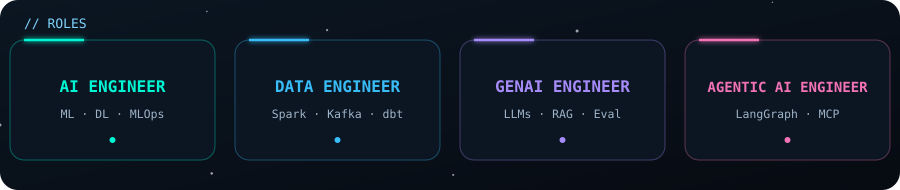
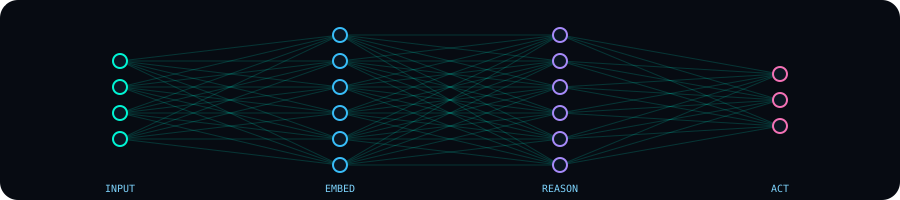
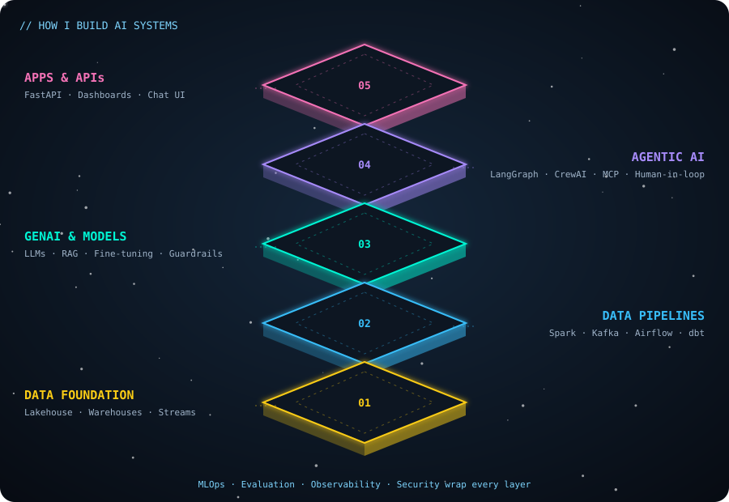

<div align="center">


<a href="https://github.com/singhkaushik550">
  
</a>

<br/><br/>



<br/>

[](https://kaushikportfolio-gold.vercel.app/)
[](https://www.linkedin.com/in/kaushiksingh2006)


</div>

---

## 👨‍💻 About Me

```python
class KaushikSingh:
    roles       = ["AI Engineer", "Data Engineer", "GenAI Engineer", "Agentic AI Engineer"]
    focus       = ["Machine Learning", "RAG & LLMs", "Multi-agent systems", "Scalable data pipelines"]
    languages   = ["Python", "SQL", "JavaScript"]
    philosophy  = "Turn raw data into actionable insights, and insights into production systems."
    currently   = "Building LLM-powered apps, agents and scalable data pipelines"
    open_to     = ["Collaborations", "Open source", "Interesting AI problems"]
```

I design and ship end-to-end **data, ML and Generative AI systems**, from messy data ingestion and feature engineering to model serving, evaluation and monitoring. I care about solutions that are **accurate, observable, secure and scalable**, not just notebooks that work once.

<div align="center">
  
</div>

---

## 🛰️ Tech Stack Orbit

<div align="center">
  
</div>

---

## 🧬 Stacks I Work Across

| Stack | Technologies |
|---|---|
| 🤖 **AI Engineering** | `PyTorch` `TensorFlow` `Scikit-learn` `XGBoost` `LightGBM` `NLP` `Time-series` `Anomaly detection` |
| 🧠 **GenAI & LLMs** | `LLMs` `Prompt & context engineering` `LoRA / QLoRA` `Hugging Face` `LangChain` `LlamaIndex` `RAGAS` |
| 🔎 **RAG & Vector Search** | `Hybrid search` `Re-ranking` `FAISS` `Chroma` `Pinecone` `pgvector` |
| 🕸️ **Agentic AI** | `LangGraph` `CrewAI` `AutoGen` `MCP` `Tool calling` `Human-in-the-loop` |
| 🏗️ **Data Engineering** | `PySpark` `Databricks` `Kafka` `Airflow` `dbt` `Delta Lake` `Great Expectations` |
| ⚙️ **MLOps & Cloud** | `MLflow` `DVC` `Docker` `Kubernetes` `GitHub Actions` `Terraform` `AWS` `Azure` `GCP` |
| 🛡️ **AI Security & Safety** | `Guardrails` `Prompt-injection defense` `PII redaction` `Red-teaming` `Output evaluation` |

<div align="center">


</div>

---

## 🏛️ How I Build AI Systems

<div align="center">
  
</div>

**Principles:** grounded answers over hallucinations · evaluation gates in CI · least-privilege access · observability on every hop · cost-aware inference.

---

## 🚀 Featured Projects

> ⚡ This table is **auto-generated**: a GitHub Action scans my public repos every hour, so new repositories show up here on their own.

<!--PROJECTS:START-->
| Project | What it does | Stack | Stars |
|---|---|---|---|
| [**Client_Data_Agent**](https://github.com/singhkaushik550/Client_Data_Agent) | AI-powered agent that automates Excel data ingestion, validation, cleaning, transformation and storage | `Python` | 0 |
| [**Student_Management_System**](https://github.com/singhkaushik550/Student_Management_System) | Full-stack application for managing student records | `JavaScript` | 0 |
<!--PROJECTS:END-->

---

## 📊 GitHub Activity

<div align="center">


</div>

---

## 🗺️ Currently Exploring

- 🔭 Production-grade **RAG** with hybrid retrieval and automated evaluation
- 🤝 **Multi-agent** systems with LangGraph and Model Context Protocol
- 🧪 **LLMOps**: prompt versioning, tracing, cost and quality monitoring
- 🛡️ **AI security**: guardrails, prompt-injection defense and red-teaming
- ☁️ Scalable data platforms on **Databricks / Spark**

---

## 📫 Let's Connect

<div align="center">

[](https://www.linkedin.com/in/kaushiksingh2006)
[](https://kaushikportfolio-gold.vercel.app/)

*Open to collaborations, open-source work and conversations about data and AI.*


</div>
