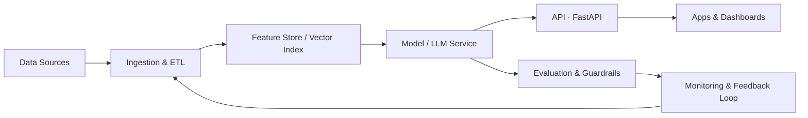

<!-- Banner -->
<div align="center">


<a href="https://github.com/singhkaushik550">
  
</a>

<br/>

[](https://kaushikportfolio-gold.vercel.app/)
[](https://www.linkedin.com/in/kaushiksingh2006)


</div>

---

## 👨‍💻 About Me

```python
class KaushikSingh:
    role        = "Data Scientist | ML & GenAI Engineer"
    focus       = ["Machine Learning", "Generative AI & RAG", "Agentic AI", "Data Engineering"]
    languages   = ["Python", "SQL", "JavaScript"]
    philosophy  = "Turn raw data into actionable insights, and insights into production systems."
    currently   = "Building LLM-powered apps and scalable data pipelines"
    open_to     = ["Collaborations", "Open source", "Interesting AI problems"]
```

I design and ship end-to-end **data, ML and Generative AI systems**, from messy data ingestion and feature engineering to model serving, evaluation and monitoring. I care about solutions that are **accurate, observable, secure and scalable**, not just notebooks that work once.

---

## 🧠 What I Work On

| | |
|---|---|
| 🤖 **Generative AI & LLMs** | Prompt & context engineering, LLM fine-tuning (LoRA / QLoRA / PEFT), guardrails, evaluation (RAGAS) |
| 🔎 **RAG & Vector Search** | Hybrid search (BM25 + dense), re-ranking, chunking, FAISS / Chroma / Pinecone / pgvector |
| 🕸️ **Agentic AI** | Multi-agent orchestration with LangGraph / CrewAI / AutoGen, tool calling, MCP, human-in-the-loop |
| 📈 **ML & Deep Learning** | Scikit-learn, XGBoost, LightGBM, PyTorch, TensorFlow, NLP, time-series, anomaly detection |
| 🏗️ **Data Engineering** | ETL / ELT, PySpark, Airflow, dbt, Kafka, medallion architecture, data quality |
| ⚙️ **MLOps & Cloud** | MLflow, DVC, Docker, Kubernetes, CI/CD with GitHub Actions, AWS · Azure · GCP |

---

## 🛠️ Tech Stack

<div align="center">

**Languages & APIs**


**ML / AI**


**Data & Databases**


**Cloud & DevOps**


**Tools**


</div>

---

## 🚀 Featured Projects

| Project | What it does | Stack |
|---|---|---|
| [**Client_Data_Agent**](https://github.com/singhkaushik550/Client_Data_Agent) | AI-powered agent that automates Excel data ingestion, validation, cleaning, transformation and storage | `Python` `Pandas` `FastAPI` `MySQL` |
| [**Student_Management_System**](https://github.com/singhkaushik550/Student_Management_System) | Full-stack app to register, view, update and delete student records with database integration | `JavaScript` `REST API` `DB` |
| [**Staff_Management_API**](https://github.com/singhkaushik550/Staff_Management_API) | Backend API for managing staff records | `Python` `FastAPI` |
| [**fastapi_mongodb**](https://github.com/singhkaushik550/fastapi_mongodb) | FastAPI service with MongoDB persistence | `Python` `FastAPI` `MongoDB` |
| [**Dataset_for_Practice**](https://github.com/singhkaushik550/Dataset_for_Practice) | Curated datasets for hands-on Data Science, ML and AI practice | `Data` `ML` |
| [**kaushik_tour_travels**](https://github.com/singhkaushik550/kaushik_tour_travels) | Travel and tours website | `HTML` `CSS` |

---

## 🏛️ How I Build AI Systems



**Principles:** grounded answers over hallucinations · evaluation gates in CI · least-privilege access · observability on every hop · cost-aware inference.

---

## 📊 GitHub Stats

<div align="center">


</div>

### 🐍 Contribution Snake

<div align="center">
  
</div>

---

## 🗺️ Currently Exploring

- 🔭 Production-grade **RAG** with hybrid retrieval and automated evaluation
- 🤝 **Multi-agent** systems with LangGraph and Model Context Protocol
- 🧪 **LLMOps**: prompt versioning, tracing, cost and quality monitoring
- ☁️ Scalable data platforms on **Databricks / Spark**

---

## 📫 Let's Connect

<div align="center">

[](https://www.linkedin.com/in/kaushiksingh2006)
[](https://kaushikportfolio-gold.vercel.app/)

*Open to collaborations, open-source work and conversations about data and AI.*


</div>
